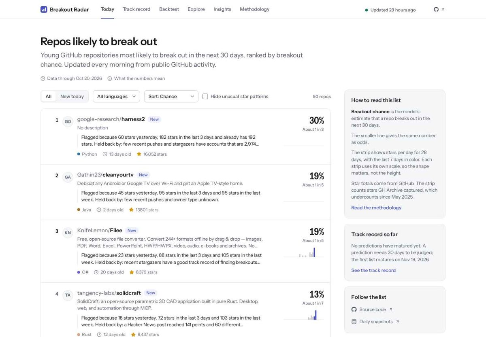
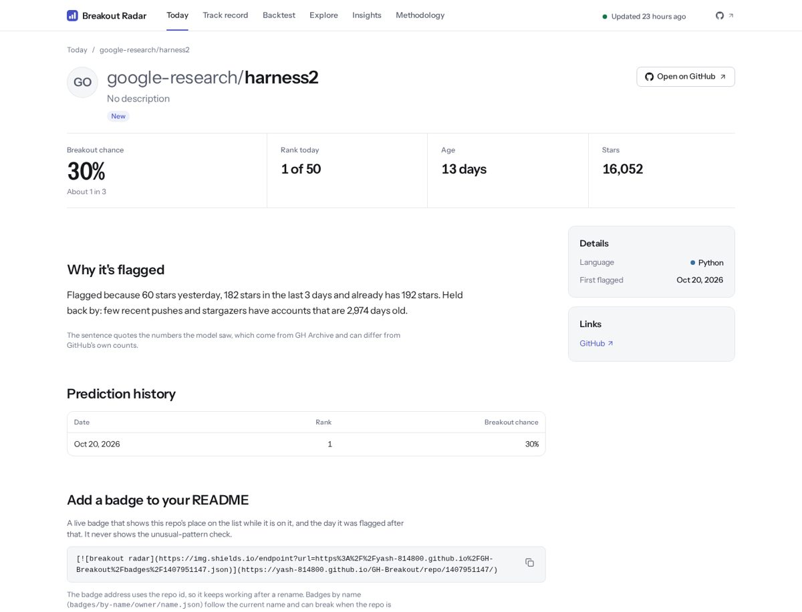
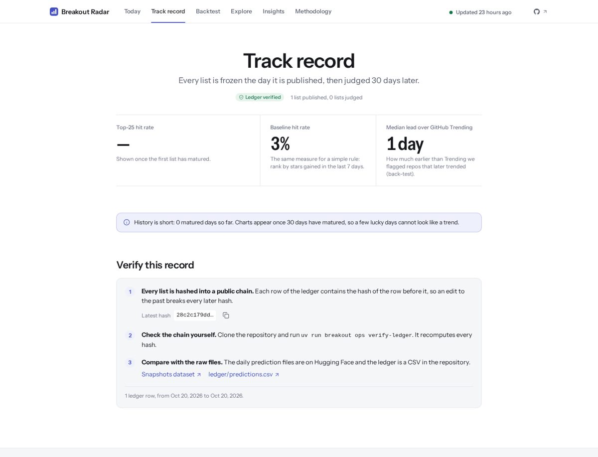
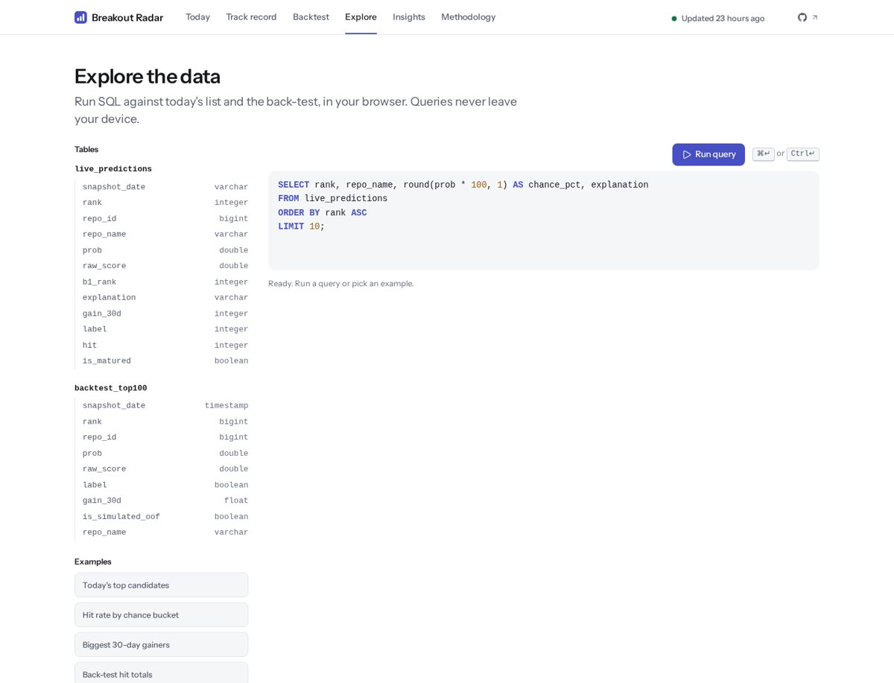
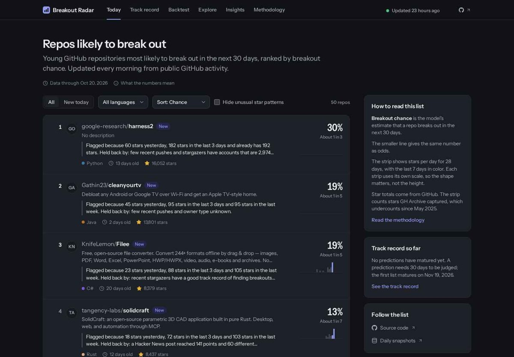
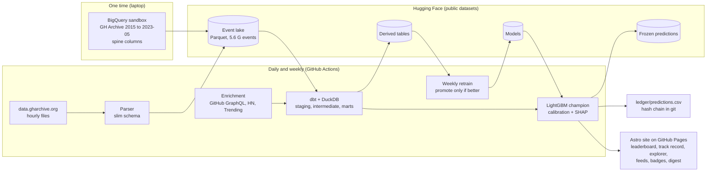

<div align="center">

# Breakout Radar

**A free, daily, public leaderboard of young GitHub repositories that are about to break out, with a track record nobody can quietly edit.**

[**Live site**](https://yash-814800.github.io/GH-Breakout/) ·
[Track record](https://yash-814800.github.io/GH-Breakout/track-record/) ·
[Methodology](https://yash-814800.github.io/GH-Breakout/methodology/) ·
[Data model docs](https://yash-814800.github.io/GH-Breakout/dbt-docs/) ·
[Blog](https://yash-814800.github.io/GH-Breakout/blog/) ·
[RSS](https://yash-814800.github.io/GH-Breakout/feed.xml)

[](https://github.com/Yash-814800/GH-Breakout/actions/workflows/ci.yml)
[](https://github.com/Yash-814800/GH-Breakout/actions/workflows/daily.yml)
[](LICENSE)


<a href="https://yash-814800.github.io/GH-Breakout/">
  
</a>

</div>

Every day thousands of new GitHub repositories get their first stars. About one in two hundred of the ones
that already have momentum gains stars at a pace most never reach in the next 30 days: a **breakout**.
Breakout Radar ranks today's candidates by that probability, explains each score in a sentence, and
records every prediction in a hash-chained ledger so the track record can be checked by anyone.

It runs entirely on free services with no credit card: GitHub Actions and Pages, Hugging Face public
datasets, DuckDB and dbt. It is also a portfolio project, so the data-quality tests, the honest
evaluation and the documentation matter as much as the model.

## Results

*Measured on 2026-10-21 from the reports in `reports/`. Cross-validated numbers are out of fold over
29 rolling-origin folds (2018-02 to 2025-05, 2.67 M candidate rows, 13,558 breakouts, 0.51% base rate).*

| | PR-AUC [95% CI] | Precision@25 [95% CI] |
|---|---|---|
| **Model** (LightGBM, calibrated) | **0.108** [0.102, 0.114] | **0.241** [0.228, 0.255] |
| Baseline: stars in the last 7 days | 0.029 [0.025, 0.035] | 0.109 [0.100, 0.118] |
| Holdout, last 26 weeks (model / baseline) | 0.158 / 0.032 | 0.338 / 0.106 |

- The model beats the baseline in **all 29 folds**; calibration error on the
  out-of-fold predictions is 0.0002 (ECE).
- **Lead time versus GitHub Trending** (3,053 trending repos, top-25 flags): 22% were flagged before they
  reached Trending, with a median lead of **1 day** (baseline: 9%, 0 days). 63% of Trending repos were
  never in the top 25. This is a modest lead and the site says so.
- **Live track record: too early to judge.** The first live list is from 2026-10-20 (day 2 of the
  record). A list is judged 30 days later, so the first live hit rate appears on **2026-11-19**. Until
  then the site shows the historical back-test, labelled as a simulation.

## Screenshots

<table>
<tr>
<td width="50%"><a href="https://yash-814800.github.io/GH-Breakout/repo/1407951147/"></a><br><sub>Repo page: why it is flagged, prediction history, momentum, similar repos and a README badge.</sub></td>
<td width="50%"><a href="https://yash-814800.github.io/GH-Breakout/track-record/"></a><br><sub>Track record: every prediction, the ledger and its hash chain.</sub></td>
</tr>
<tr>
<td width="50%"><a href="https://yash-814800.github.io/GH-Breakout/explore/"></a><br><sub>Explore: SQL in the browser (DuckDB-WASM over Parquet served by the site).</sub></td>
<td width="50%"><a href="https://yash-814800.github.io/GH-Breakout/"></a><br><sub>Light and dark themes, from 360 px phones to wide screens.</sub></td>
</tr>
</table>

## Architecture



More detail, including where every piece of data lives, is in [docs/ARCHITECTURE.md](docs/ARCHITECTURE.md).

## Runs for $0

| Service | Used for | Free limit | Current use |
|---|---|---|---|
| GitHub Actions (public repo, standard runners) | Daily pipeline, weekly retrain, CI, the 41-job hourly backfill | Unlimited minutes for public repos; 6 h per job | Daily run about 4 min, weekly about 10 min |
| GitHub Pages | The website | About 1 GB site, 100 GB/month soft bandwidth | About 60 MB (DuckDB-WASM, data model docs) |
| Hugging Face Hub (public datasets) | Event lake, derived tables, daily snapshots, models | Best effort for public repos; keep commits small | 116.7 GB in 4 repos (events 115 GB in 1,628 files) |
| Google BigQuery sandbox (no billing account) | One-time history backfill, run locally | 1 TB of queries per month | 522.7 GB billed for all of 2015 to 2023-05; nothing left to scan |
| GitHub REST/GraphQL API (token with no scopes) | Repo metadata and current star counts | 5,000 requests per hour | A few hundred requests a day |
| Hacker News Algolia API | Hacker News mentions as a feature | Public, no key | Small |

Detailed limits and a dated check against the official documentation are in
[reports/final_audit.md](reports/final_audit.md).

## Technical highlights

- **Layered dbt models** ([browse the lineage](https://yash-814800.github.io/GH-Breakout/dbt-docs/),
  [data dictionary](docs/data_dictionary.md)): 52 models in four layers, with every column described and
  274 dbt tests. Big models are built in hash buckets so 4.3 billion events fit in a 4 GB cap.
- **Sessionization and cohorts in plain SQL.** Contributor sessions split a user's activity at 30-minute
  gaps, and weekly stargazer cohorts measure who later forks, comments or opens a pull request:
  ```sql
  case when lag(created_at) over w is null
         or created_at - lag(created_at) over w > interval '30 minutes' then 1 else 0 end as is_new
  -- running sum over the same window gives session_id; see dbt/models/intermediate/
  ```
- **Point-in-time features and a leak test.** Features for snapshot `D` use events strictly before `D`.
  `breakout build leak-test` rebuilds 71 columns for 300 sampled repos from inputs cut at `D` and requires
  every value to match; a mutation check (`<` to `<=`) proves it can fail.
- **Rolling-origin evaluation with an embargo.** Never a random split; a 30-day embargo equals the label
  horizon; metrics per year; the model must beat the baseline on PR-AUC and precision@k to be promoted.
- **Calibration** on data the booster never trained on (isotonic), and **SHAP sentences**: each score comes
  with "Flagged because ... Held back by ..." built from the feature dictionary.
- **Immutable track record.** Each day's predictions are frozen on Hugging Face and one row is appended to
  `ledger/predictions.csv`; each row hashes the previous one, and `breakout ops verify-ledger` checks the chain.
- **Suspicious-growth detector.** Six transparent signals on a candidate's recent stargazers (new accounts,
  no prior activity, bulk starring, one-hour bursts, lockstep co-starring, no later engagement) give a
  neutral "unusual star pattern" label. It never changes the score and never says "fake".
- **Distribution for free:** RSS and JSON feeds, shields.io badges for flagged repos, a weekly digest and a
  GitHub Discussions post, all generated from the frozen snapshots.
- **DuckDB versus ClickHouse**, measured on the same Parquet files: see the
  [benchmark post](https://yash-814800.github.io/GH-Breakout/blog/duckdb-vs-clickhouse/) and
  [benchmarks/](benchmarks/).

Quality gates: 390 Python tests, 274 dbt tests, 41 Vitest and 178 Playwright tests (layout,
content, accessibility, visual snapshots), Lighthouse 99 to 100 on performance, ruff and mypy clean.

## Reproduce it

Prerequisites: Python 3.12 with [uv](https://docs.astral.sh/uv/), Node 22 for the site, about 20 GB free
disk for a small slice. The one-time history backfill (BigQuery, about 18 hours) and the hourly backfill
(about 2 TB of downloads, run in GitHub Actions) are **not** needed to try the project: the finished
lake is public on Hugging Face.

```bash
git clone https://github.com/Yash-814800/GH-Breakout && cd GH-Breakout
make setup                         # uv sync --all-groups + pre-commit
make lint && make test             # ruff, mypy, pytest (no credentials needed)

uv run breakout info               # versions and paths
uv run breakout lake pull --types WatchEvent --since 2026-07-01   # only the types and dates a step needs
uv run breakout daily run --date 2026-10-20 --no-upload --no-commit   # score one day against HF data

cd site && npm ci && npm run build:fx && npx playwright test         # the website on fixture data
```

Run a slice instead of the full history by pulling only the last three months (`--since`). What to set up by hand (tokens, secrets, Pages)
is in [docs/HUMAN_SETUP.md](docs/HUMAN_SETUP.md), and operations (rerun a failed day, roll back a model,
rotate a token) are in [docs/runbook.md](docs/runbook.md).

## Data

All data is public and MIT licensed (dataset cards on each repo). It comes from
[GH Archive](https://www.gharchive.org/) and the public GitHub API; thanks to GH Archive for the stream.

| Dataset | Content |
|---|---|
| [gh-breakout-events](https://huggingface.co/datasets/Yasshh814/gh-breakout-events) | Slim GH Archive event lake, 2015 to now (Parquet, hive partitions) |
| [gh-breakout-derived](https://huggingface.co/datasets/Yasshh814/gh-breakout-derived) | Enrichment tables, training rows, site data bundles, weekly digests |
| [gh-breakout-snapshots](https://huggingface.co/datasets/Yasshh814/gh-breakout-snapshots) | The frozen daily predictions and their outcomes |
| [gh-breakout-models](https://huggingface.co/Yasshh814/gh-breakout-models) | Model packages, registry and model card |

The suspicious-growth work is validated against the StarScout dataset (He et al., ICSE 2026; Apache 2.0).
Repository owners can ask for removal through an [issue](https://github.com/Yash-814800/GH-Breakout/issues/new?template=review-request.md).

## Limitations

- **Live evidence is short.** The track record began on 2026-10-20. Cross-validated results are
  simulations on 2018 to May 2025 data, not live results.
- **GH Archive star capture collapsed from 2025-05-24** (about 1% of the 2024 level by mid-2026). Training
  and evaluation end 2025-05-23; live star counts shown on the site come from the GitHub API, while the
  model's own features are event based. Live probabilities are therefore calibrated to the earlier era.
- **GitHub trimmed event payloads on 2025-10-07.** The live model uses only features that survive the trim;
  its behaviour after the trim cannot be evaluated on history.
- **Probabilities are calibrated on Monday snapshots.** On other weekdays the model over-predicts a little
  (observed over expected positives 0.73 against 0.90 on Mondays); ranking is unaffected.
- **Detail and enrichment features add no measurable lift** over the star-dynamics features alone.
- **Attention outside GitHub is invisible**, apart from Hacker News links. Unstars cannot be observed, and
  the unusual-pattern label is a statistical flag, not a judgement about anyone.
- **One developer, free tiers.** Hugging Face and GitHub can change their free limits; the runbook says
  what to do when they do.

## License

Code: [MIT](LICENSE). Data: MIT, with the attribution notes above. To cite, see [CITATION.cff](CITATION.cff).
Not affiliated with GitHub, Inc.
