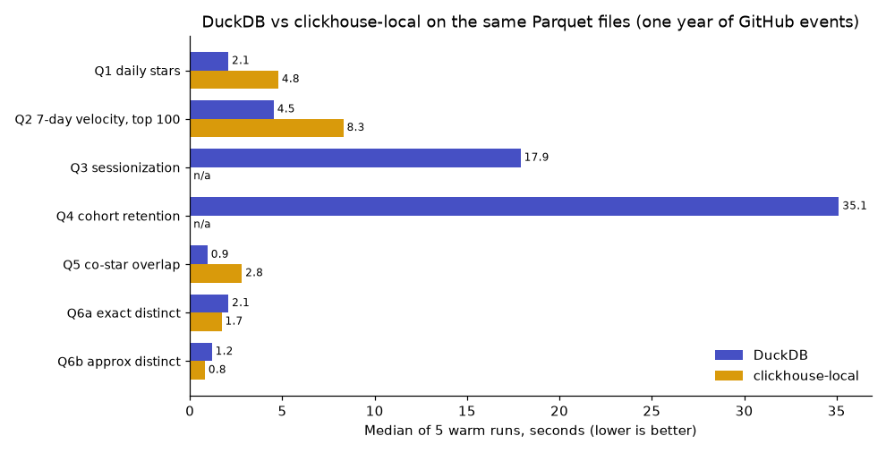

Breakout Radar runs its whole data pipeline with DuckDB, because DuckDB is a library: it starts in a GitHub Actions job, reads Parquet, and exits. Nothing has to be hosted. That is a reason to pick it, not a measurement, so this post measures it. The question is narrow: **on one laptop and the same Parquet files, how do DuckDB and ClickHouse compare on the kind of queries this project actually runs?**

[ClickHouse](https://clickhouse.com/) is the natural comparison because `clickhouse-local` is also a single binary with no server. Everything here is scripted in [`benchmarks/`](https://github.com/Yash-814800/GH-Breakout/tree/main/benchmarks) and the raw numbers are in `benchmarks/results.json` and `benchmarks/results_highmem.json`.

## Setup

| | |
|---|---|
| Machine | AMD Ryzen 5 5600H (6 cores, 12 threads), 14.9 GB RAM, Linux 7.2 (Fedora), data on the internal SSD |
| Engines | DuckDB 1.5.6 (Python API) and ClickHouse local 26.8.32.14 (official LTS build, one binary) |
| Data | One year (2022) of `WatchEvent` (56.5 M rows), `IssueCommentEvent` (69.4 M) and `PullRequestEvent` (129.8 M) from the project's lake: 4.5 GB of Parquet, the very same files for both engines |
| Resources | 4 threads and a 4 GB engine memory limit each; the whole process under a 6 GB cgroup cap. ClickHouse also gets external group-by and sort spilling at a third of the limit and `join_algorithm = auto` |
| Method | For every query and engine: the data files are evicted from the OS page cache (`posix_fadvise`, no root needed), then one cold run and five warm runs, each in a fresh process. Times are in-engine query times; peak memory is the resident set of the process |
| Result check | Every query ends in a small result (an aggregate row or a top-N list). The harness compares the two engines' outputs exactly |

## The queries

Both dialects of every query are in [`benchmarks/sql/`](https://github.com/Yash-814800/GH-Breakout/tree/main/benchmarks/sql).

1. **Daily stars per repo** for the year: one `GROUP BY (repo_id, day)` over 56 M events.
2. **Top 100 repos by 7-day star velocity on 12 dates**: a `RANGE` window per repo over the daily table, then `row_number()` per date.
3. **Sessionization of comments with a 30-minute gap**: `LAG` plus a running `SUM` over 69 M comments, partitioned by (repo, actor).
4. **Weekly stargazer cohort retention**: a join of every first star (tens of millions) with 199 M later comments and pull-request events of the same actor and repo within 28 days.
5. **Co-star overlap of the 100 most-starred repos**: a self-join on actor.
6. **Distinct actors per month**, exact (`COUNT(DISTINCT)` / `uniqExact`) and approximate (`approx_count_distinct` / `uniq`).

## Results

All numbers are seconds, medians of five warm runs unless stated. Lower is better.

| Query | DuckDB median / min (s) | ClickHouse median / min (s) | ClickHouse vs DuckDB (median) | Peak memory DuckDB / ClickHouse (MB) | Same result |
|---|---|---|---|---|---|
| Q1 daily stars | 2.08 / 1.99 | 4.78 / 4.53 | 2.3x slower | 1132 / 3160 | yes |
| Q2 7-day velocity, top 100 | 4.53 / 4.50 | 8.30 / 8.03 | 1.8x slower | 1338 / 3296 | yes |
| Q3 sessionization | 17.90 / 16.21 | did not finish / did not finish | - | 4393 / 4432 | n/a |
| Q4 cohort retention | 35.12 / 34.43 | did not finish / did not finish | - | 4798 / 4240 | n/a |
| Q5 co-star overlap | 0.95 / 0.94 | 2.81 / 2.75 | 3.0x slower | 593 / 2451 | yes |
| Q6a exact distinct | 2.08 / 1.95 | 1.71 / 1.65 | 1.2x faster | 1133 / 1149 | yes |
| Q6b approx distinct | 1.18 / 1.17 | 0.81 / 0.79 | 1.5x faster | 92 / 464 | estimate |

Cold run (first run after dropping the data files from the page cache), seconds:

| Query | DuckDB cold | ClickHouse cold |
|---|---|---|
| Q1 daily stars | 3.14 | 5.53 |
| Q2 7-day velocity, top 100 | 5.91 | 9.30 |
| Q3 sessionization | 21.43 | did not finish |
| Q4 cohort retention | 38.09 | did not finish |
| Q5 co-star overlap | 1.78 | 6.00 |
| Q6a exact distinct | 2.53 | 2.72 |
| Q6b approx distinct | 2.09 | 2.62 |

Queries that did not finish at 4 GB, repeated with a 6.0 GB engine memory limit (same data, threads and method), seconds:

| Query | DuckDB median / min | ClickHouse median / min | ClickHouse vs DuckDB | Peak memory DuckDB / ClickHouse (MB) | Same result |
|---|---|---|---|---|---|
| Q3 sessionization | 14.66 / 13.82 | 24.97 / 23.48 | 1.7x slower | 5302 / 5188 | yes |
| Q4 cohort retention | 33.83 / 29.97 | 50.98 / 50.65 | 1.5x slower | 6508 / 5268 | yes |

Approximate distinct count, error against the exact count (12 months): DuckDB mean 14.06%, max 32.80%; ClickHouse mean 0.60%, max 1.25%.

## What the numbers say

- **DuckDB was faster on five of the seven.** On the two plain aggregations, the window query and the self-join (Q1, Q2, Q5) it was 1.8 to 3 times faster than ClickHouse and used a third of the memory (for example 1.1 GB against 3.2 GB for Q1).
- **ClickHouse could not finish Q3 and Q4 within 4 GB**, where DuckDB did (spilling to disk, peak 4.4 and 4.8 GB). The failure is `memory limit exceeded` in the window and join stages, which ClickHouse keeps in memory. With a 6 GB limit both finished, and DuckDB was still 1.5 to 1.7 times faster. Both engines returned identical results every time.
- **ClickHouse was faster on the distinct counts**: 1.2 times for the exact count and 1.5 times for the approximate one. This is the kind of query it was built for.
- **The approximate counters are not equivalent.** Against the exact count, ClickHouse's `uniq` was off by 0.6% on average (at most 1.25%). DuckDB's `approx_count_distinct` was off by 14% on average and by up to 33% (a month with 1.23 M actors came out as 1.63 M). If you pick the approximate function for its speed, check its error on your own data first.
- **Cold runs** (data not in the page cache) cost 8% to 90% more than warm ones for DuckDB (Q4 38 s against 35 s, Q5 1.8 s against 0.95 s) and 16% to 2.1 times more for ClickHouse (Q1 5.5 s against 4.8 s, Q5 6.0 s against 2.8 s). The cost is reading the Parquet footers and the data from disk.

## Why the project uses DuckDB

The result is a consequence, not the reason. The reason is the shape of the pipeline: a daily GitHub Actions job on a free runner (a few GB of RAM, a fresh disk, no persistent server) that reads Parquet from Hugging Face, runs dbt models and exits. DuckDB is a library with a dbt adapter, runs the same SQL on the laptop and in CI, and spills to disk when memory is short, which mattered because the history build ran under a 4 GB cap. The browser SQL explorer on the site is DuckDB-WASM, so the same engine runs in the visitor's tab. ClickHouse would be the choice for a shared, always-on analytical service ingesting continuously, which this project is not.

## Caveats, so you can discount them properly

- **One machine, one dataset, one year.** The queries come from this project's feature work, not from a standard benchmark. A different CPU, data size or query mix can change the ranking.
- **Parquet, not native storage.** ClickHouse's strength is its own MergeTree format with sorting keys and indexes; it was deliberately not used here. Loaded into MergeTree and tuned, it would very likely be faster, at the price of an ingest step and a server.
- **Defaults, mostly.** Neither engine was tuned beyond threads, memory and (for ClickHouse) spilling and join settings. A ClickHouse expert might write Q3 and Q4 to use less memory; the queries are written to be semantically equal, not to be the best in each dialect.
- **Memory limits decide the outcome of the two big queries.** The 4 GB limit reflects this project's constraint (a 4 GB cap for heavy jobs). The 6 GB rerun is reported in the same table.
- **Peak memory is the resident set size** of the process, which includes file pages mapped from the Parquet files.
- **Versions matter.** DuckDB 1.5.6 and ClickHouse 26.8.32.14. Both projects ship fast; re-run `benchmarks/run.py` before quoting these numbers.
- Cold runs drop the page cache for the data files only; engine start-up is included in neither time (in-engine time is reported), and the SSD is the same for both.

Everything above can be reproduced with the instructions in [`benchmarks/README.md`](https://github.com/Yash-814800/GH-Breakout/blob/main/benchmarks/README.md). All seven queries are reported; none was left out.
