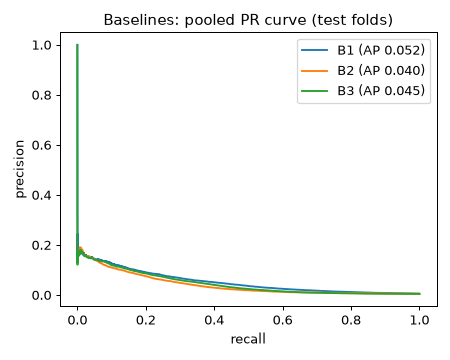
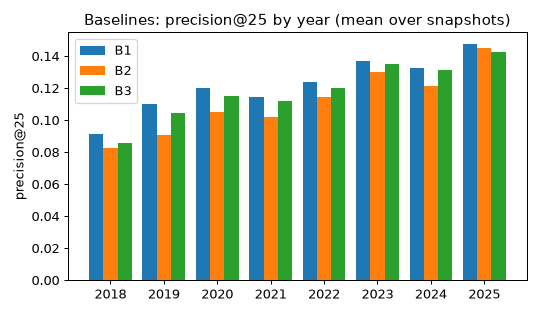

# Baseline evaluation (Phase 6)

Every later model must beat **B1** on PR-AUC and precision@k to be promoted.

## Setup

- Candidates: age <= 90 d, < 200 stars before D, >= 5 stars in [D-14, D), no forks / mirrors / bot owners.
- Label (primary): `breakout_rel` = 30-day gain >= max(100, 0.995 quantile of the candidates on that snapshot).
- Rolling-origin, expanding window: test blocks of 3 months, first block after 2 years, embargo 30 days. 29 folds; test snapshots 2018-02-01 .. 2025-05-01.
- Data: GH Archive trusted era (events before 2025-05-24).
- Confidence intervals: block bootstrap over snapshot dates (1000 resamples, blocks of 4 weeks).
- precision@k = hits in top k / k per snapshot, averaged over all snapshots; recall@k and AP are averaged over snapshots with at least one positive. Ties are broken by repo_id.

Baselines:

- **B1**: stars in the last 7 days (ties: last day)
- **B2**: 7-day stars / (stars so far + 10)
- **B3**: 7-day stars minus the 7 days before

## Folds

| fold | test_start | test_end | train_snaps | test_snaps | test_pos | B1 PR-AUC | B1 P@25 | B2 PR-AUC | B2 P@25 | B3 PR-AUC | B3 P@25 |
|---|---|---|---|---|---|---|---|---|---|---|---|
| 0 | 2018-02-01 | 2018-05-01 | 105 | 13 | 289 | 0.038 | 0.068 | 0.034 | 0.058 | 0.034 | 0.062 |
| 1 | 2018-05-01 | 2018-08-01 | 117 | 13 | 267 | 0.046 | 0.108 | 0.035 | 0.086 | 0.039 | 0.098 |
| 2 | 2018-08-01 | 2018-11-01 | 131 | 13 | 248 | 0.050 | 0.098 | 0.047 | 0.095 | 0.048 | 0.102 |
| 3 | 2018-11-01 | 2019-02-01 | 144 | 13 | 250 | 0.048 | 0.105 | 0.045 | 0.098 | 0.045 | 0.092 |
| 4 | 2019-02-01 | 2019-05-01 | 157 | 13 | 314 | 0.036 | 0.080 | 0.030 | 0.083 | 0.032 | 0.077 |
| 5 | 2019-05-01 | 2019-08-01 | 170 | 13 | 326 | 0.051 | 0.117 | 0.038 | 0.086 | 0.043 | 0.102 |
| 6 | 2019-08-01 | 2019-11-01 | 183 | 13 | 300 | 0.060 | 0.132 | 0.047 | 0.105 | 0.052 | 0.129 |
| 7 | 2019-11-01 | 2020-02-01 | 196 | 13 | 283 | 0.041 | 0.102 | 0.034 | 0.086 | 0.038 | 0.111 |
| 8 | 2020-02-01 | 2020-05-01 | 209 | 13 | 347 | 0.046 | 0.105 | 0.035 | 0.086 | 0.039 | 0.092 |
| 9 | 2020-05-01 | 2020-08-01 | 222 | 13 | 420 | 0.048 | 0.114 | 0.035 | 0.098 | 0.041 | 0.120 |
| 10 | 2020-08-01 | 2020-11-01 | 235 | 13 | 354 | 0.073 | 0.163 | 0.057 | 0.148 | 0.063 | 0.154 |
| 11 | 2020-11-01 | 2021-02-01 | 248 | 13 | 328 | 0.048 | 0.092 | 0.035 | 0.077 | 0.040 | 0.083 |
| 12 | 2021-02-01 | 2021-05-01 | 261 | 13 | 343 | 0.053 | 0.138 | 0.042 | 0.117 | 0.047 | 0.138 |
| 13 | 2021-05-01 | 2021-08-01 | 274 | 13 | 327 | 0.060 | 0.126 | 0.046 | 0.120 | 0.050 | 0.120 |
| 14 | 2021-08-01 | 2021-11-01 | 287 | 13 | 287 | 0.047 | 0.098 | 0.036 | 0.080 | 0.040 | 0.098 |
| 15 | 2021-11-01 | 2022-02-01 | 300 | 14 | 350 | 0.039 | 0.103 | 0.036 | 0.106 | 0.036 | 0.103 |
| 16 | 2022-02-01 | 2022-05-01 | 313 | 12 | 338 | 0.049 | 0.107 | 0.037 | 0.107 | 0.040 | 0.107 |
| 17 | 2022-05-01 | 2022-08-01 | 326 | 13 | 349 | 0.053 | 0.111 | 0.040 | 0.105 | 0.045 | 0.105 |
| 18 | 2022-08-01 | 2022-11-01 | 339 | 14 | 408 | 0.063 | 0.149 | 0.052 | 0.131 | 0.055 | 0.146 |
| 19 | 2022-11-01 | 2023-02-01 | 352 | 13 | 365 | 0.058 | 0.132 | 0.043 | 0.111 | 0.049 | 0.120 |
| 20 | 2023-02-01 | 2023-05-01 | 366 | 12 | 448 | 0.064 | 0.137 | 0.051 | 0.137 | 0.053 | 0.140 |
| 21 | 2023-05-01 | 2023-08-01 | 378 | 14 | 512 | 0.069 | 0.154 | 0.049 | 0.140 | 0.055 | 0.151 |
| 22 | 2023-08-01 | 2023-11-01 | 391 | 13 | 417 | 0.047 | 0.120 | 0.040 | 0.123 | 0.042 | 0.123 |
| 23 | 2023-11-01 | 2024-02-01 | 405 | 13 | 390 | 0.071 | 0.132 | 0.059 | 0.132 | 0.062 | 0.126 |
| 24 | 2024-02-01 | 2024-05-01 | 418 | 13 | 442 | 0.060 | 0.138 | 0.048 | 0.135 | 0.052 | 0.142 |
| 25 | 2024-05-01 | 2024-08-01 | 431 | 13 | 507 | 0.063 | 0.148 | 0.045 | 0.123 | 0.054 | 0.145 |
| 26 | 2024-08-01 | 2024-11-01 | 444 | 13 | 442 | 0.046 | 0.111 | 0.036 | 0.092 | 0.039 | 0.105 |
| 27 | 2024-11-01 | 2025-02-01 | 457 | 13 | 464 | 0.064 | 0.157 | 0.049 | 0.138 | 0.056 | 0.160 |
| 28 | 2025-02-01 | 2025-05-01 | 470 | 12 | 580 | 0.062 | 0.137 | 0.043 | 0.147 | 0.050 | 0.127 |

## Pooled test metrics (all folds)

| baseline | PR-AUC [95% CI] | ROC-AUC | mean AP | P@10 | P@25 | P@50 | R@10 | R@25 | R@50 |
|---|---|---|---|---|---|---|---|---|---|
| B1 | 0.0520 [0.0491, 0.0551] | 0.8212 | 0.072 [0.068, 0.076] | 0.145 [0.132, 0.157] | 0.120 [0.113, 0.127] | 0.095 [0.090, 0.101] | 0.054 | 0.110 | 0.172 |
| B2 | 0.0405 [0.0382, 0.0429] | 0.7512 | 0.061 [0.057, 0.065] | 0.141 [0.129, 0.153] | 0.109 [0.102, 0.115] | 0.088 [0.083, 0.092] | 0.052 | 0.099 | 0.159 |
| B3 | 0.0447 [0.0421, 0.0473] | 0.7181 | 0.065 [0.061, 0.069] | 0.142 [0.129, 0.154] | 0.116 [0.110, 0.124] | 0.094 [0.089, 0.098] | 0.053 | 0.107 | 0.169 |

Test rows 2,099,174, positives 10,695 (positive rate 0.5095%).

### Calibration of B1 (isotonic, fitted on each fold's training dates)

Brier 0.00494, log loss 0.02715, ECE (10 quantile bins) 0.00060.

## Per year (mean over the year's test snapshots)

**B1**

| year | n_snapshots | ap | precision@10 | precision@25 | precision@50 |
|---|---|---|---|---|---|
| 2018 | 48 | 0.065 | 0.119 | 0.092 | 0.068 |
| 2019 | 52 | 0.068 | 0.140 | 0.110 | 0.080 |
| 2020 | 52 | 0.072 | 0.137 | 0.120 | 0.099 |
| 2021 | 52 | 0.073 | 0.154 | 0.115 | 0.083 |
| 2022 | 52 | 0.074 | 0.150 | 0.124 | 0.095 |
| 2023 | 52 | 0.077 | 0.148 | 0.137 | 0.110 |
| 2024 | 53 | 0.073 | 0.158 | 0.133 | 0.117 |
| 2025 | 16 | 0.079 | 0.156 | 0.147 | 0.140 |

**B2**

| year | n_snapshots | ap | precision@10 | precision@25 | precision@50 |
|---|---|---|---|---|---|
| 2018 | 48 | 0.059 | 0.113 | 0.083 | 0.066 |
| 2019 | 52 | 0.060 | 0.129 | 0.091 | 0.075 |
| 2020 | 52 | 0.059 | 0.127 | 0.105 | 0.088 |
| 2021 | 52 | 0.063 | 0.142 | 0.102 | 0.081 |
| 2022 | 52 | 0.063 | 0.137 | 0.115 | 0.089 |
| 2023 | 52 | 0.064 | 0.171 | 0.130 | 0.103 |
| 2024 | 53 | 0.060 | 0.160 | 0.122 | 0.098 |
| 2025 | 16 | 0.055 | 0.156 | 0.145 | 0.133 |

**B3**

| year | n_snapshots | ap | precision@10 | precision@25 | precision@50 |
|---|---|---|---|---|---|
| 2018 | 48 | 0.061 | 0.115 | 0.086 | 0.069 |
| 2019 | 52 | 0.062 | 0.138 | 0.105 | 0.079 |
| 2020 | 52 | 0.064 | 0.131 | 0.115 | 0.097 |
| 2021 | 52 | 0.066 | 0.150 | 0.112 | 0.082 |
| 2022 | 52 | 0.066 | 0.142 | 0.120 | 0.095 |
| 2023 | 52 | 0.067 | 0.152 | 0.135 | 0.107 |
| 2024 | 53 | 0.066 | 0.157 | 0.131 | 0.112 |
| 2025 | 16 | 0.067 | 0.156 | 0.143 | 0.134 |

## Lead time versus GitHub Trending

Population: repos that appeared on an all-languages GitHub Trending list within 60 days of a test snapshot whose window has Trending coverage (>= 54 of 60 days). First flag = earliest snapshot in which the repo ranked in the top 25; snapshot resolution is weekly, so a flag is visible at most 7 days late. Positive lead = we flagged before Trending; a repo flagged only after it trended counts as not early.

| baseline | trending repos | flagged (top-25) | never flagged | flagged before Trending | >= 7 d before | median lead (d) | IQR (d) |
|---|---|---|---|---|---|---|---|
| B1 | 2836 | 703 | 0.752 | 0.117 | 0.046 | 0.0 | 0.0 .. 2.0 |
| B2 | 2836 | 589 | 0.792 | 0.122 | 0.041 | 1.0 | 0.0 .. 3.0 |
| B3 | 2836 | 647 | 0.772 | 0.116 | 0.042 | 1.0 | 0.0 .. 2.0 |

## Figures

## Sanity check: top 10 B1-ranked candidates on three historical dates

`gain_30d` is the realized gain in [D, D+30); `label` is `breakout_rel`.

**2019-11-25**

| repo_name_at_D | stars_7d | stars_1d | stars_total_before | gain_30d | label |
|---|---|---|---|---|---|
| psliwka/vim-smoothie | 199 | 2 | 199 | 30 | False |
| Tencent/wwsearch | 195 | 2 | 195 | 48 | False |
| wei-tim/YOWO | 192 | 6 | 194 | 85 | False |
| connor4312/cockatiel | 177 | 112 | 177 | 610 | True |
| opheron/electric-hive-learning-guide | 174 | 5 | 174 | 13 | False |
| alirezadir/Production-Level-Deep-Learning | 161 | 90 | 161 | 1603 | True |
| fuzzitdev/javafuzz | 143 | 5 | 143 | 18 | False |
| heybourn/headwind | 142 | 6 | 142 | 33 | False |
| replicatedhq/kotsadm | 137 | 0 | 137 | 11 | False |
| vmware-tanzu/antrea | 135 | 3 | 135 | 135 | False |

**2021-09-13**

| repo_name_at_D | stars_7d | stars_1d | stars_total_before | gain_30d | label |
|---|---|---|---|---|---|
| ghealer/GUI_Tools | 198 | 5 | 198 | 151 | False |
| 0voice/Understanding_in_Rust | 191 | 5 | 192 | 166 | False |
| Uahh/slscq | 182 | 32 | 182 | 166 | False |
| antfu/github-doorcat | 172 | 5 | 172 | 36 | False |
| vuejs/repl | 172 | 3 | 172 | 34 | False |
| fishfight/FishFight | 167 | 2 | 173 | 37 | False |
| peng-zhihui/OpenHeat | 165 | 79 | 171 | 157 | False |
| rails/jsbundling-rails | 164 | 12 | 164 | 76 | False |
| ventusff/neurecon | 163 | 10 | 163 | 89 | False |
| threathunters-io/laurel | 154 | 2 | 154 | 44 | False |

**2024-03-25**

| repo_name_at_D | stars_7d | stars_1d | stars_total_before | gain_30d | label |
|---|---|---|---|---|---|
| jarvis2f/vortex | 199 | 14 | 199 | 63 | False |
| mlecauchois/micrograd-cuda | 195 | 5 | 196 | 8 | False |
| ZHO-ZHO-ZHO/ComfyUI-APISR | 184 | 7 | 184 | 55 | False |
| noobnooc/AssisChat | 183 | 1 | 183 | 11 | False |
| mistralai-sf24/hackathon | 181 | 152 | 181 | 240 | False |
| paviro/ESPHome-ePaper-Calendar | 181 | 7 | 181 | 25 | False |
| JesusDgz291104/coreldraw-app | 180 | 180 | 180 | 1 | False |
| misbahsy/RAGTune | 179 | 11 | 179 | 43 | False |
| Abhay5855/Mission-frontend | 176 | 27 | 176 | 326 | True |
| donydchen/mvsplat | 175 | 20 | 175 | 161 | False |

