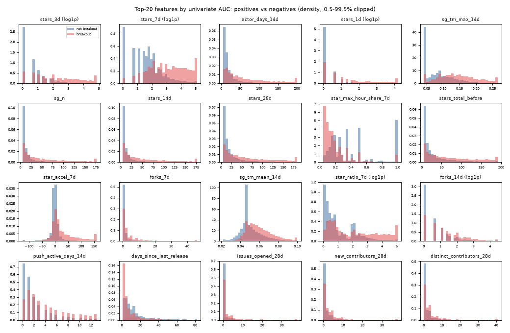
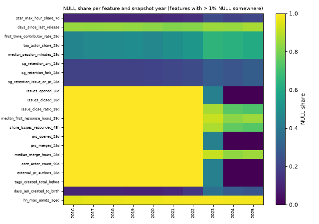
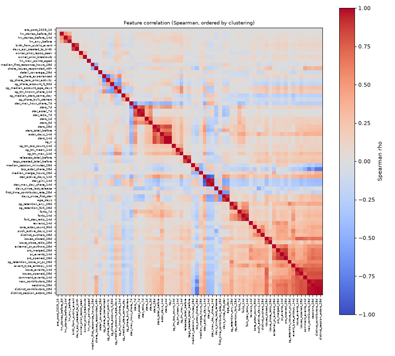

# Feature EDA (Phase 7)

Training table: 3,098,574 candidate-snapshot rows, 71 features, label `breakout_rel`. dbt git sha `3ee9068a446216abe0d248e0da242f867e5f29e2`, dictionary sha256 `49d9891cbff5`. Univariate numbers only; they describe association, not a model (Phase 8).

## Positive rate by year

| year | rows | positives | positive rate |
|---|---|---|---|
| 2016 | 190,364 | 981 | 0.515% |
| 2017 | 217,516 | 1,117 | 0.514% |
| 2018 | 235,103 | 1,204 | 0.512% |
| 2019 | 262,977 | 1,348 | 0.513% |
| 2020 | 311,582 | 1,585 | 0.509% |
| 2021 | 279,747 | 1,418 | 0.507% |
| 2022 | 341,416 | 1,734 | 0.508% |
| 2023 | 547,801 | 2,778 | 0.507% |
| 2024 | 513,712 | 2,605 | 0.507% |
| 2025 | 198,356 | 1,003 | 0.506% |

## Top 20 features by univariate AUC

AUC of the raw feature as a score for `breakout_rel` over all rows with a non-NULL value (0.5 = no signal; below 0.5 the feature points the other way). The velocity baseline B1 (`stars_7d`) has ROC-AUC 0.821 pooled (Phase 6).

| feature | tier | auc | auc_dir | non_null_share |
|---|---|---|---|---|
| stars_3d | A | 0.817 | higher = more likely | 100.0% |
| stars_7d | A | 0.811 | higher = more likely | 100.0% |
| actor_days_14d | A | 0.784 | higher = more likely | 100.0% |
| stars_1d | A | 0.779 | higher = more likely | 100.0% |
| sg_tm_max_14d | A | 0.779 | higher = more likely | 100.0% |
| sg_n | A | 0.774 | higher = more likely | 100.0% |
| stars_14d | A | 0.774 | higher = more likely | 100.0% |
| stars_28d | A | 0.761 | higher = more likely | 100.0% |
| star_max_hour_share_7d | A | 0.241 | lower = more likely | 84.7% |
| stars_total_before | A | 0.733 | higher = more likely | 100.0% |
| star_accel_7d | A | 0.712 | higher = more likely | 100.0% |
| forks_7d | A | 0.712 | higher = more likely | 100.0% |
| sg_tm_mean_14d | A | 0.709 | higher = more likely | 100.0% |
| star_ratio_7d | A | 0.705 | higher = more likely | 100.0% |
| forks_14d | A | 0.685 | higher = more likely | 100.0% |
| push_active_days_14d | A | 0.683 | higher = more likely | 100.0% |
| days_since_last_release | A | 0.327 | lower = more likely | 16.1% |
| issues_opened_28d | B | 0.660 | higher = more likely | 32.9% |
| new_contributors_28d | A | 0.651 | higher = more likely | 100.0% |
| distinct_contributors_28d | A | 0.651 | higher = more likely | 100.0% |

## Weakest features (closest to AUC 0.5)

| feature | auc | non_null_share |
|---|---|---|
| hn_stories_before_3d | 0.518 | 100.0% |
| sg_share_zero_prior_activity | 0.516 | 100.0% |
| hn_max_points_aged | 0.512 | 2.2% |
| issue_close_ratio_28d | 0.512 | 8.4% |
| sg_share_bulk_starrers | 0.510 | 100.0% |
| sg_share_account_lt_30d | 0.491 | 100.0% |
| owner_prior_repos_seen | 0.509 | 100.0% |
| median_merge_hours_28d | 0.504 | 5.2% |
| detail_coverage_28d | 0.499 | 100.0% |
| era_post_2025_10 | 0.500 | 100.0% |

## NULL rates by year

Tier B (payload detail) is expected to be NULL before `history.detail_start_date` (2023-06-01), never filled with 0. Features with > 1% NULL in some year:

| feature | tier | 2016 | 2017 | 2018 | 2019 | 2020 | 2021 | 2022 | 2023 | 2024 | 2025 |
|---|---|---|---|---|---|---|---|---|---|---|---|
| star_max_hour_share_7d | A | 10% | 10% | 10% | 10% | 11% | 12% | 14% | 23% | 19% | 21% |
| days_since_last_release | A | 85% | 84% | 85% | 84% | 82% | 81% | 82% | 85% | 85% | 87% |
| first_time_contributor_rate_28d | A | 45% | 47% | 48% | 49% | 46% | 50% | 53% | 65% | 64% | 61% |
| top_actor_share_28d | A | 45% | 47% | 48% | 49% | 46% | 50% | 53% | 65% | 64% | 61% |
| median_session_minutes_28d | A | 45% | 47% | 48% | 49% | 46% | 50% | 53% | 65% | 64% | 61% |
| sg_retention_any_28d | A | 20% | 20% | 19% | 19% | 20% | 21% | 23% | 29% | 27% | 29% |
| sg_retention_fork_28d | A | 20% | 20% | 19% | 19% | 20% | 21% | 23% | 29% | 27% | 29% |
| sg_retention_issue_or_pr_28d | A | 20% | 20% | 19% | 19% | 20% | 21% | 23% | 29% | 27% | 29% |
| issues_opened_28d | B | 100% | 100% | 100% | 100% | 100% | 100% | 100% | 44% | 0% | 0% |
| issues_closed_28d | B | 100% | 100% | 100% | 100% | 100% | 100% | 100% | 44% | 0% | 0% |
| issue_close_ratio_28d | B | 100% | 100% | 100% | 100% | 100% | 100% | 100% | 87% | 74% | 72% |
| median_first_response_hours_28d | B | 100% | 100% | 100% | 100% | 100% | 100% | 100% | 92% | 82% | 85% |
| share_issues_responded_48h | B | 100% | 100% | 100% | 100% | 100% | 100% | 100% | 88% | 75% | 74% |
| prs_opened_28d | B | 100% | 100% | 100% | 100% | 100% | 100% | 100% | 44% | 0% | 0% |
| prs_merged_28d | B | 100% | 100% | 100% | 100% | 100% | 100% | 100% | 44% | 0% | 0% |
| median_merge_hours_28d | B | 100% | 100% | 100% | 100% | 100% | 100% | 100% | 91% | 83% | 85% |
| core_actor_count_90d | B | 100% | 100% | 100% | 100% | 100% | 100% | 100% | 44% | 0% | 0% |
| external_pr_authors_28d | B | 100% | 100% | 100% | 100% | 100% | 100% | 100% | 44% | 0% | 0% |
| tags_created_total_before | B | 100% | 100% | 100% | 100% | 100% | 100% | 100% | 44% | 0% | 0% |
| days_api_created_to_birth | C | 10% | 10% | 10% | 9% | 10% | 11% | 16% | 37% | 29% | 27% |
| hn_max_points_aged | C | 95% | 96% | 97% | 97% | 98% | 98% | 99% | 99% | 98% | 98% |

## Correlation clusters (|Spearman rho| >= 0.8)

Average-linkage clusters on a sample of 263,071 rows (all positives plus a hash sample of negatives). Features in one cluster carry mostly the same information; tree models cope, linear models and SHAP attributions are affected.

1. `distinct_contributors_28d`, `distinct_session_actors_28d`, `new_contributors_28d`, `sessions_28d`
2. `actor_days_14d`, `sg_n`, `stars_14d`
3. `pr_events_14d`, `prs_merged_28d`, `prs_opened_28d`
4. `star_active_days_14d`, `star_gini_14d`, `star_max_day_share_14d`
5. `age_days`, `days_since_first_star`
6. `birth_from_public_event`, `days_api_created_to_birth`
7. `fork_star_ratio_14d`, `forks_14d`
8. `issue_events_14d`, `issues_opened_28d`
9. `releases_total_before`, `tags_created_total_before`
10. `star_accel_7d`, `star_ratio_7d`
11. `stars_28d`, `stars_total_before`

