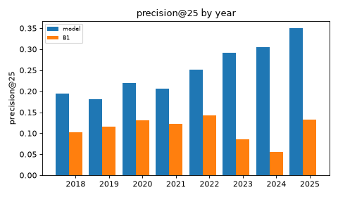
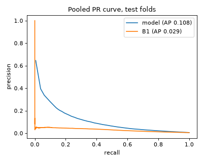
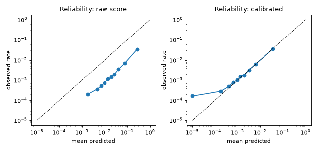

# Model evaluation: LightGBM vs velocity baselines (Phase 8)

Rolling-origin CV with the Phase 6 folds and metrics (`breakout ml cv`); every number is out-of-fold. The baselines are scored on exactly the same rows.

## Setup

- Label `breakout_rel`; folds: expanding window, 3-month test blocks, embargo 30 days, 29 folds, test snapshots 2018-02-01 .. 2025-05-01.
- Features: the 68 live-available allowed features (`config/feature_dictionary.yaml`); LightGBM, seed 42, deterministic, 1 thread.
- Per fold: the last 3 months of the training dates (after an embargo of 30 days) are the inner validation set for early stopping (AP) and for the calibrator; 12 configs of the grid x `scale_pos_weight` [1.0, 3.0] are tried and the best inner-validation AP wins. Negatives are subsampled to 10% for fitting (all positives kept); the validation rows are not sampled, so the calibrator is fitted on real-balance data.
- CIs: block bootstrap over snapshot dates (1000 resamples, 4-week blocks); differences are paired (same resamples).

## Folds (model vs B1)

| fold | test_start | test_end | test_pos | model PR-AUC | model P@25 | B1 PR-AUC | B1 P@25 | iter | cal |
|---|---|---|---|---|---|---|---|---|---|
| 0 | 2018-02-01 | 2018-05-01 | 326 | 0.126 | 0.218 | 0.039 | 0.077 | 148 | isotonic |
| 1 | 2018-05-01 | 2018-08-01 | 295 | 0.142 | 0.209 | 0.053 | 0.123 | 320 | isotonic |
| 2 | 2018-08-01 | 2018-11-01 | 276 | 0.125 | 0.191 | 0.050 | 0.105 | 205 | isotonic |
| 3 | 2018-11-01 | 2019-02-01 | 274 | 0.113 | 0.157 | 0.051 | 0.111 | 187 | isotonic |
| 4 | 2019-02-01 | 2019-05-01 | 349 | 0.095 | 0.185 | 0.043 | 0.098 | 95 | isotonic |
| 5 | 2019-05-01 | 2019-08-01 | 360 | 0.095 | 0.160 | 0.054 | 0.111 | 83 | isotonic |
| 6 | 2019-08-01 | 2019-11-01 | 332 | 0.126 | 0.209 | 0.058 | 0.135 | 43 | isotonic |
| 7 | 2019-11-01 | 2020-02-01 | 313 | 0.112 | 0.172 | 0.045 | 0.114 | 220 | isotonic |
| 8 | 2020-02-01 | 2020-05-01 | 386 | 0.103 | 0.212 | 0.045 | 0.111 | 216 | isotonic |
| 9 | 2020-05-01 | 2020-08-01 | 462 | 0.115 | 0.222 | 0.051 | 0.126 | 121 | isotonic |
| 10 | 2020-08-01 | 2020-11-01 | 392 | 0.129 | 0.222 | 0.077 | 0.175 | 115 | isotonic |
| 11 | 2020-11-01 | 2021-02-01 | 366 | 0.129 | 0.234 | 0.054 | 0.114 | 38 | isotonic |
| 12 | 2021-02-01 | 2021-05-01 | 385 | 0.147 | 0.234 | 0.055 | 0.145 | 122 | isotonic |
| 13 | 2021-05-01 | 2021-08-01 | 366 | 0.148 | 0.222 | 0.060 | 0.126 | 122 | isotonic |
| 14 | 2021-08-01 | 2021-11-01 | 321 | 0.124 | 0.194 | 0.053 | 0.114 | 141 | isotonic |
| 15 | 2021-11-01 | 2022-02-01 | 394 | 0.126 | 0.194 | 0.047 | 0.120 | 178 | isotonic |
| 16 | 2022-02-01 | 2022-05-01 | 379 | 0.121 | 0.243 | 0.051 | 0.120 | 123 | isotonic |
| 17 | 2022-05-01 | 2022-08-01 | 391 | 0.125 | 0.234 | 0.058 | 0.126 | 183 | isotonic |
| 18 | 2022-08-01 | 2022-11-01 | 510 | 0.142 | 0.269 | 0.065 | 0.166 | 162 | isotonic |
| 19 | 2022-11-01 | 2023-02-01 | 504 | 0.114 | 0.234 | 0.049 | 0.135 | 21 | isotonic |
| 20 | 2023-02-01 | 2023-05-01 | 670 | 0.159 | 0.323 | 0.017 | 0.037 | 451 | isotonic |
| 21 | 2023-05-01 | 2023-08-01 | 1040 | 0.145 | 0.374 | 0.018 | 0.080 | 109 | isotonic |
| 22 | 2023-08-01 | 2023-11-01 | 546 | 0.117 | 0.218 | 0.027 | 0.114 | 271 | isotonic |
| 23 | 2023-11-01 | 2024-02-01 | 514 | 0.167 | 0.283 | 0.039 | 0.098 | 121 | isotonic |
| 24 | 2024-02-01 | 2024-05-01 | 727 | 0.167 | 0.335 | 0.028 | 0.071 | 243 | isotonic |
| 25 | 2024-05-01 | 2024-08-01 | 731 | 0.151 | 0.342 | 0.019 | 0.049 | 190 | isotonic |
| 26 | 2024-08-01 | 2024-11-01 | 545 | 0.121 | 0.234 | 0.024 | 0.034 | 215 | isotonic |
| 27 | 2024-11-01 | 2025-02-01 | 580 | 0.163 | 0.302 | 0.040 | 0.086 | 54 | isotonic |
| 28 | 2025-02-01 | 2025-05-01 | 824 | 0.170 | 0.377 | 0.031 | 0.133 | 467 | isotonic |

## Pooled test metrics

|  | PR-AUC [95% CI] | ROC-AUC | mean AP | P@10 | P@25 | P@50 | R@10 | R@25 | R@50 |
|---|---|---|---|---|---|---|---|---|---|
| model | 0.1081 [0.1016, 0.1142] | 0.883 | 0.153 [0.147, 0.159] | 0.340 [0.321, 0.357] | 0.241 [0.228, 0.255] | 0.176 [0.166, 0.186] | 0.102 | 0.178 | 0.259 |
| B1 | 0.0286 [0.0246, 0.0345] | 0.816 | 0.063 [0.058, 0.068] | 0.129 [0.115, 0.143] | 0.109 [0.100, 0.118] | 0.086 [0.080, 0.092] | 0.044 | 0.090 | 0.139 |
| B2 | 0.0197 [0.0168, 0.0240] | 0.741 | 0.052 [0.047, 0.056] | 0.125 [0.112, 0.138] | 0.098 [0.089, 0.107] | 0.078 [0.072, 0.083] | 0.042 | 0.081 | 0.128 |
| B3 | 0.0227 [0.0191, 0.0279] | 0.711 | 0.056 [0.051, 0.060] | 0.126 [0.112, 0.139] | 0.105 [0.097, 0.114] | 0.083 [0.077, 0.089] | 0.043 | 0.087 | 0.136 |

Test rows 2,667,524, positives 13,558 (rate 0.5083%).

### Model minus baseline (paired)

| vs | PR-AUC diff [CI] | P@25 diff [CI] | model clearly better |
|---|---|---|---|
| B1 | +0.0794 [+0.0698, +0.0875] | +0.132 [+0.116, +0.149] | yes |
| B2 | +0.0884 [+0.0798, +0.0956] | +0.143 [+0.126, +0.161] | yes |
| B3 | +0.0854 [+0.0762, +0.0930] | +0.136 [+0.119, +0.153] | yes |

## Per year (mean over the year's test snapshots)

**model**

| year | n_snapshots | ap | precision@10 | precision@25 | precision@50 |
|---|---|---|---|---|---|
| 2018 | 48 | 0.151 | 0.300 | 0.195 | 0.132 |
| 2019 | 52 | 0.131 | 0.265 | 0.181 | 0.129 |
| 2020 | 52 | 0.143 | 0.304 | 0.219 | 0.164 |
| 2021 | 52 | 0.157 | 0.313 | 0.207 | 0.156 |
| 2022 | 52 | 0.157 | 0.325 | 0.252 | 0.181 |
| 2023 | 52 | 0.158 | 0.421 | 0.291 | 0.210 |
| 2024 | 53 | 0.169 | 0.419 | 0.306 | 0.226 |
| 2025 | 16 | 0.178 | 0.419 | 0.350 | 0.273 |

**B1**

| year | n_snapshots | ap | precision@10 | precision@25 | precision@50 |
|---|---|---|---|---|---|
| 2018 | 48 | 0.069 | 0.131 | 0.102 | 0.076 |
| 2019 | 52 | 0.070 | 0.158 | 0.116 | 0.087 |
| 2020 | 52 | 0.073 | 0.140 | 0.132 | 0.106 |
| 2021 | 52 | 0.075 | 0.162 | 0.123 | 0.092 |
| 2022 | 52 | 0.078 | 0.165 | 0.143 | 0.113 |
| 2023 | 52 | 0.042 | 0.088 | 0.085 | 0.063 |
| 2024 | 53 | 0.036 | 0.058 | 0.055 | 0.057 |
| 2025 | 16 | 0.054 | 0.144 | 0.133 | 0.106 |

## Ablations

Same folds, 3 configs per fold (cheaper search). Deltas are against `abl_full_cheap` (all live features, same search).

| variant | complete | PR-AUC | P@25 | PR-AUC delta [CI] | P@25 delta [CI] |
|---|---|---|---|---|---|
| abl_full_cheap | yes | 0.1069 | 0.239 | - | - |
| abl_tier_A | yes | 0.1131 | 0.240 | +0.0062 [-0.0014, +0.0146] | +0.001 [-0.004, +0.007] |
| abl_tier_AB | yes | 0.1038 | 0.242 | -0.0032 [-0.0111, +0.0060] | +0.003 [-0.003, +0.008] |
| abl_no_tastemaker | yes | 0.1058 | 0.235 | -0.0012 [-0.0084, +0.0066] | -0.004 [-0.009, +0.001] |
| abl_no_stargazers | yes | 0.1043 | 0.237 | -0.0026 [-0.0110, +0.0046] | -0.002 [-0.007, +0.003] |
| abl_star_dynamics_only | yes | 0.0642 | 0.204 | -0.0428 [-0.0536, -0.0297] | -0.035 [-0.050, -0.022] |

Tier A = spine-only features (all eras); A+B adds the payload-detail features (NULL before 2023-06); A+B+C = `abl_full_cheap` adds enrichment (metadata, Hacker News).

### Monotone constraints

`stars_7d, sg_share_experienced` constrained non-decreasing, same search as `full`: PR-AUC 0.1070 (diff -0.0011 [-0.0054, +0.0030]), P@25 0.238 (diff -0.003 [-0.008, +0.002]). Decision: **no constraints** (kept only if neither metric is lower).

## Sanity checks

- (a) Model trained on labels shuffled within each snapshot, evaluated on the true test labels: PR-AUC 0.0058 vs positive rate 0.0051 (limit 0.0102): **PASS**.
- (a') The final out-of-fold scores against test labels shuffled within each snapshot: PR-AUC 0.0050 vs rate 0.0051: **PASS**.
- (b) A model on `stars_7d` alone: PR-AUC 0.0290, P@25 0.104 vs B1 0.0286 / 0.109 (B1 breaks ties with the last day's stars; the single-feature model has coarse ties).

## Calibration (pooled out-of-fold)

|  | brier | log_loss | ece |
|---|---|---|---|
| raw score | 0.01291 | 0.06255 | 0.04227 |
| calibrated | 0.00471 | 0.02462 | 0.00022 |

The raw score comes from boosters fitted on 10% of the negatives, so it is not a probability; the calibrator (isotonic on the inner validation block, Platt below 200 positives) maps it to the real base rate. Calibrators per fold: {'isotonic': np.int64(29)}.

Reliability (10 equal-count bins):

| bin | n | n_pos | mean_pred | observed |
|---|---|---|---|---|
| 1 | 266753 | 44 | 0.00000 | 0.00016 |
| 2 | 266753 | 75 | 0.00018 | 0.00028 |
| 3 | 266753 | 130 | 0.00042 | 0.00049 |
| 4 | 266753 | 207 | 0.00064 | 0.00078 |
| 5 | 266752 | 267 | 0.00095 | 0.00100 |
| 6 | 266752 | 396 | 0.00129 | 0.00148 |
| 7 | 266752 | 462 | 0.00192 | 0.00173 |
| 8 | 266752 | 855 | 0.00317 | 0.00321 |
| 9 | 266752 | 1708 | 0.00630 | 0.00640 |
| 10 | 266752 | 9414 | 0.03650 | 0.03529 |

## Slices (pooled within the slice; rows ranked together)

**language**

| language | rows | positives | model PR-AUC | B1 PR-AUC | model ROC-AUC | B1 ROC-AUC |
|---|---|---|---|---|---|---|
| C# | 65559 | 224 | 0.091 | 0.030 | 0.861 | 0.829 |
| C++ | 83436 | 424 | 0.099 | 0.041 | 0.872 | 0.814 |
| Go | 85585 | 903 | 0.098 | 0.064 | 0.820 | 0.771 |
| HTML | 61436 | 226 | 0.094 | 0.056 | 0.908 | 0.866 |
| Java | 75746 | 406 | 0.107 | 0.067 | 0.878 | 0.844 |
| JavaScript | 224400 | 985 | 0.122 | 0.057 | 0.888 | 0.845 |
| Jupyter Notebook | 76146 | 467 | 0.112 | 0.069 | 0.891 | 0.830 |
| Other | 488070 | 2010 | 0.089 | 0.043 | 0.866 | 0.820 |
| Python | 443440 | 3333 | 0.130 | 0.080 | 0.879 | 0.830 |
| Rust | 62380 | 538 | 0.098 | 0.044 | 0.832 | 0.772 |
| TypeScript | 185321 | 1749 | 0.133 | 0.079 | 0.870 | 0.819 |
| Unknown | 816005 | 2293 | 0.088 | 0.011 | 0.883 | 0.810 |

**detail coverage**

| detail coverage | rows | positives | model PR-AUC | B1 PR-AUC | model ROC-AUC | B1 ROC-AUC |
|---|---|---|---|---|---|---|
| full (1) | 945771 | 4794 | 0.120 | 0.025 | 0.899 | 0.816 |
| none (0) | 1647172 | 8384 | 0.103 | 0.033 | 0.872 | 0.816 |
| partial (0, 1) | 74581 | 380 | 0.152 | 0.020 | 0.929 | 0.806 |

**era_post_2025_10**

| era_post_2025_10 | rows | positives | model PR-AUC | B1 PR-AUC | model ROC-AUC | B1 ROC-AUC |
|---|---|---|---|---|---|---|
| 0 | 2667524 | 13558 | 0.108 | 0.029 | 0.883 | 0.816 |

`era_post_2025_10` is 0 for every test row (the trusted era ends 2025-05-23), so there is nothing to split; the post-trim behaviour is untested by construction (ADR-009, ADR-022).

## Lead time versus GitHub Trending (top-25 flags)

|  | trending repos | never flagged | flagged before Trending | >= 7 d before | median lead (d) | IQR (d) |
|---|---|---|---|---|---|---|
| model | 3053 | 0.628 | 0.222 | 0.065 | 1.0 | 0.0 .. 2.0 |
| B1 | 3053 | 0.801 | 0.088 | 0.034 | 0.0 | 0.0 .. 2.0 |
| B2 | 3053 | 0.840 | 0.091 | 0.032 | 1.0 | 0.0 .. 4.0 |
| B3 | 3053 | 0.820 | 0.087 | 0.032 | 0.0 | 0.0 .. 2.0 |

## Daily versus weekly scoring

Daily snapshots 2025-03-25 .. 2025-04-21 (28 days) scored with the evaluation model of `20261019-b5ff585` (trained without these dates), features and labels from the history SQL on a warehouse copy.

| weekday | snapshots | rows | positives | PR-AUC | P@25 | B1 P@25 | expected positives | observed/expected |
|---|---|---|---|---|---|---|---|---|
| Mon | 4 | 51574 | 261 | 0.202 | 0.410 | 0.160 | 290.905 | 0.897 |
| Tue | 4 | 53062 | 267 | 0.188 | 0.340 | 0.160 | 361.035 | 0.740 |
| Wed | 4 | 53240 | 268 | 0.169 | 0.370 | 0.140 | 373.574 | 0.717 |
| Thu | 4 | 52383 | 264 | 0.193 | 0.420 | 0.170 | 391.643 | 0.674 |
| Fri | 4 | 51718 | 261 | 0.225 | 0.400 | 0.170 | 380.410 | 0.686 |
| Sat | 4 | 51629 | 261 | 0.179 | 0.390 | 0.190 | 357.860 | 0.729 |
| Sun | 4 | 51736 | 260 | 0.170 | 0.350 | 0.190 | 309.344 | 0.840 |

- Mean precision@25: Mondays minus other days +0.032 [-0.008, +0.075] (bootstrap over days).
- Observed / expected positives (calibration): Mondays 0.90, other days 0.73 (1.00 = perfectly calibrated).
- Calibrated-probability ECE over all days: 0.00170.
- With 4-5 snapshots per weekday each cell is noisy; the comparison that matters is Monday versus the rest.

## Chosen hyperparameters per fold

| fold | num_leaves | min_data_in_leaf | feature_fraction | learning_rate | lambda_l2 | scale_pos_weight | iter | val AP | val pos |
|---|---|---|---|---|---|---|---|---|---|
| 0 | 31 | 50 | 0.800 | 0.030 | 0.000 | 1.000 | 148 | 0.154 | 316 |
| 1 | 15 | 500 | 0.600 | 0.030 | 0.000 | 3.000 | 320 | 0.154 | 319 |
| 2 | 15 | 500 | 0.600 | 0.030 | 0.000 | 3.000 | 205 | 0.122 | 306 |
| 3 | 15 | 50 | 0.600 | 0.030 | 5.000 | 1.000 | 187 | 0.167 | 301 |
| 4 | 63 | 50 | 0.800 | 0.050 | 5.000 | 3.000 | 95 | 0.103 | 294 |
| 5 | 63 | 50 | 0.800 | 0.050 | 0.000 | 1.000 | 83 | 0.125 | 314 |
| 6 | 63 | 50 | 0.800 | 0.050 | 5.000 | 3.000 | 43 | 0.098 | 375 |
| 7 | 63 | 50 | 0.600 | 0.030 | 5.000 | 1.000 | 220 | 0.143 | 360 |
| 8 | 31 | 200 | 0.800 | 0.050 | 5.000 | 1.000 | 216 | 0.121 | 326 |
| 9 | 63 | 200 | 0.800 | 0.050 | 5.000 | 3.000 | 121 | 0.129 | 333 |
| 10 | 63 | 50 | 0.800 | 0.050 | 5.000 | 3.000 | 115 | 0.109 | 503 |
| 11 | 31 | 50 | 0.800 | 0.030 | 0.000 | 1.000 | 38 | 0.122 | 440 |
| 12 | 63 | 50 | 0.600 | 0.050 | 0.000 | 3.000 | 122 | 0.152 | 376 |
| 13 | 63 | 50 | 0.600 | 0.030 | 5.000 | 1.000 | 122 | 0.147 | 376 |
| 14 | 31 | 50 | 0.800 | 0.030 | 0.000 | 1.000 | 141 | 0.158 | 402 |
| 15 | 63 | 50 | 0.600 | 0.030 | 5.000 | 1.000 | 178 | 0.134 | 396 |
| 16 | 63 | 50 | 0.800 | 0.050 | 0.000 | 1.000 | 123 | 0.109 | 304 |
| 17 | 63 | 50 | 0.600 | 0.030 | 5.000 | 1.000 | 183 | 0.166 | 409 |
| 18 | 63 | 50 | 0.800 | 0.030 | 5.000 | 3.000 | 162 | 0.128 | 434 |
| 19 | 31 | 200 | 0.800 | 0.050 | 5.000 | 1.000 | 21 | 0.150 | 456 |
| 20 | 63 | 50 | 0.600 | 0.030 | 5.000 | 1.000 | 451 | 0.162 | 532 |
| 21 | 15 | 200 | 0.600 | 0.050 | 0.000 | 1.000 | 109 | 0.160 | 615 |
| 22 | 63 | 50 | 0.800 | 0.050 | 0.000 | 1.000 | 271 | 0.185 | 1047 |
| 23 | 63 | 50 | 0.600 | 0.030 | 5.000 | 1.000 | 121 | 0.166 | 706 |
| 24 | 63 | 50 | 0.800 | 0.050 | 5.000 | 3.000 | 243 | 0.158 | 557 |
| 25 | 63 | 50 | 0.600 | 0.030 | 5.000 | 1.000 | 190 | 0.159 | 600 |
| 26 | 63 | 50 | 0.600 | 0.030 | 5.000 | 1.000 | 215 | 0.169 | 779 |
| 27 | 63 | 50 | 0.800 | 0.050 | 0.000 | 1.000 | 54 | 0.150 | 663 |
| 28 | 63 | 50 | 0.800 | 0.030 | 5.000 | 3.000 | 467 | 0.174 | 571 |

